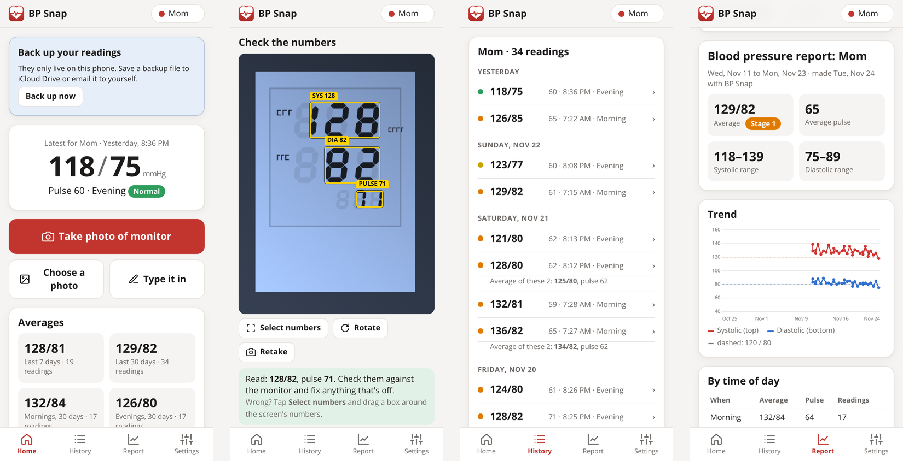

# BP Snap

Take a photo of a blood pressure monitor. BP Snap reads the numbers, you check them, and it keeps a log with the date and time, per person, on your phone.

**Open it on your iPhone:** https://devanshi-code18.github.io/bp-snap/



- **Photo in, numbers out.** Reads the seven-segment screen (SYS, DIA, pulse) right in the browser. No upload, no account.
- **You stay in charge.** Every reading is shown on the photo for you to confirm or fix before it's saved. If the first read misses, drag a box around the numbers, or type them.
- **Timing.** Uses the photo's capture time, tags morning / afternoon / evening / night, shows morning vs evening averages, how many mornings and evenings you measured this week, and averages readings taken minutes apart as one sitting.
- **Several people on one phone.** Switch person from the top right.
- **Trends and a doctor-ready report.** 7 / 30 / 90-day averages, a chart, ACC/AHA categories, print to PDF, CSV export or share.
- **Reminders.** Adds daily morning and evening reminders to your calendar.
- **Works offline** once opened, and installs to the Home Screen like an app.

## Use it

1. Open https://devanshi-code18.github.io/bp-snap/ in Safari.
2. Tap Share, then **Add to Home Screen**. (Safari can clear a website's data after 7 days without a visit; Home Screen apps keep it.)
3. Enter whose readings these are. Measure as usual, and when the final numbers show, tap **Take photo of monitor**.
4. Check the numbers against the monitor and tap **Save reading**.

Photo tips: hold the phone straight over the screen, fill most of the frame with the display, and tilt a little if there is glare.

## Your data

Readings (and a small copy of each photo, optional) are stored in the browser on your phone (IndexedDB). There is no server. Use **Settings → Save backup** now and then and keep the file in Files / iCloud Drive; **Restore backup** brings it back on any phone. **Report → CSV** or **Share** sends the log to a doctor.

## How well it reads

The reader is plain JavaScript (`js/ocr/sevenseg.js`), no model download and no network.

| Test set | SYS + DIA right | SYS + DIA + pulse right |
| --- | --- | --- |
| 15 real monitor photos from Wikimedia Commons, whole photo | 13 / 15 | 11 / 15 |
| Same monitors, photo framed on the display | 12 / 14 | 11 / 14 |
| 60 synthetic monitor screens (slant, gaps, glare, noise, blur) | 54 / 60 | 49 / 60 |

On 24 photos without a digital reading (cuffs, dial gauges, blank screens) it reported a reading on 1. Misses so far: red LED and wide-gap hospital displays. That's why every reading is shown for a check before saving.

How it works: grayscale and a light blur; ink = darker than the local background (a grey closing, so a whole LCD panel stays background); digit-shaped blobs at a few merge radii seed one band per number; in each band it removes the italic slant, cuts digits at empty columns, and decodes each digit from its seven segment zones. It does this under several thresholds and both polarities, and the same digits at the same place count as votes. SYS, DIA and pulse are then picked by value range, size and layout (SYS above DIA, pulse smaller and under or right of DIA).

## Not a medical device

BP Snap is a log. Check numbers against the monitor and discuss readings with a doctor. Categories follow the ACC/AHA guideline: normal < 120/80, elevated 120–129/<80, stage 1 130–139 or 80–89, stage 2 ≥ 140 or ≥ 90; above 180/120 the app shows the AHA advice to re-measure and contact a doctor.

## Development

Plain HTML, CSS and ES modules. No build step, no runtime dependencies.

```sh
python3 -m http.server 8080        # open http://localhost:8080
npm test                           # unit tests: reader, stats, EXIF
npm run eval                       # reader accuracy on 60 synthetic monitor photos
npm install --no-save puppeteer-core
CHROME_PATH=/path/to/chrome npm run e2e    # iPhone-sized browser smoke test
```

`node tests/eval-real.mjs <dir>` scores real photos (`NN.rgba` + `meta.json`); `tools/screens.mjs` regenerates the README screenshots; `tools/make-icons.mjs` the app icons.

Every push to `main` runs the unit tests and the browser test, then deploys to GitHub Pages (`.github/workflows/pages.yml`).

## License

MIT
